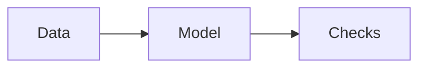

## Overview

An AI system is a model plus the data, tools and checks around it.

![[diagram.svg|320]]

## Evaluation

Measure with a fixed test set, then compare against [[Architecture Notes]].

Inside code, `[[not a link]]` and `==not a highlight==` stay as written.
